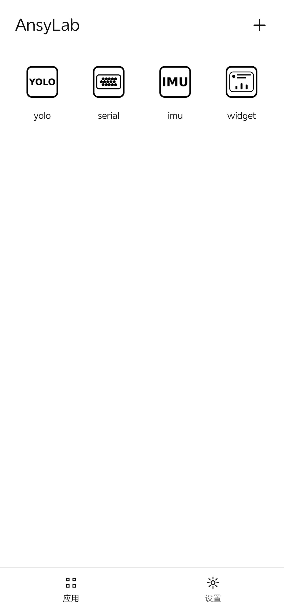
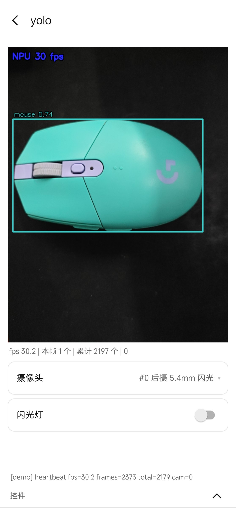
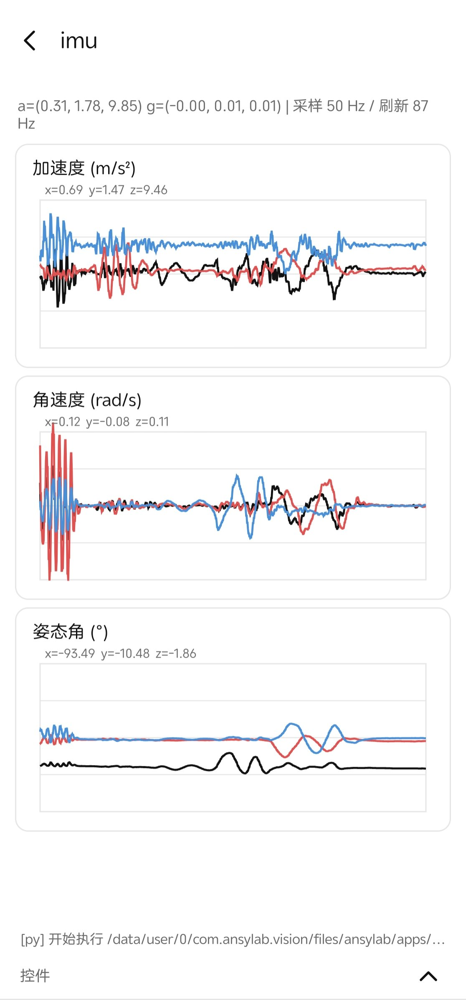
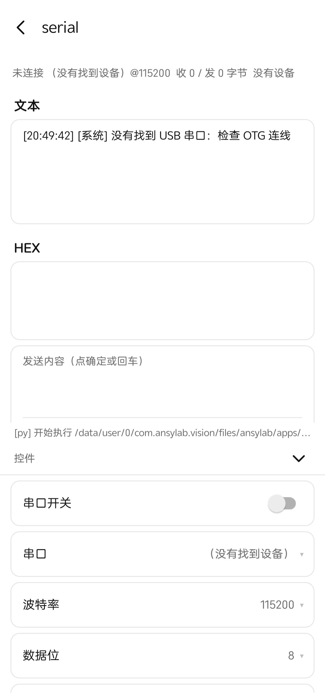
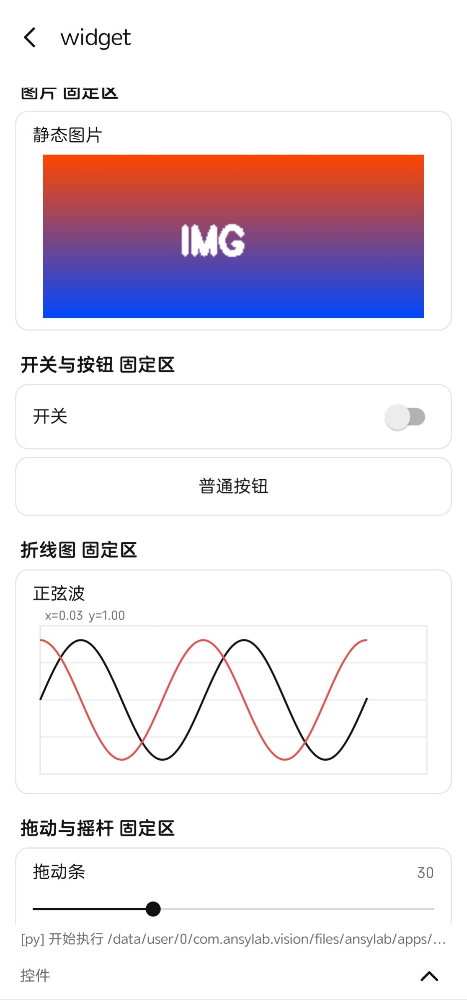
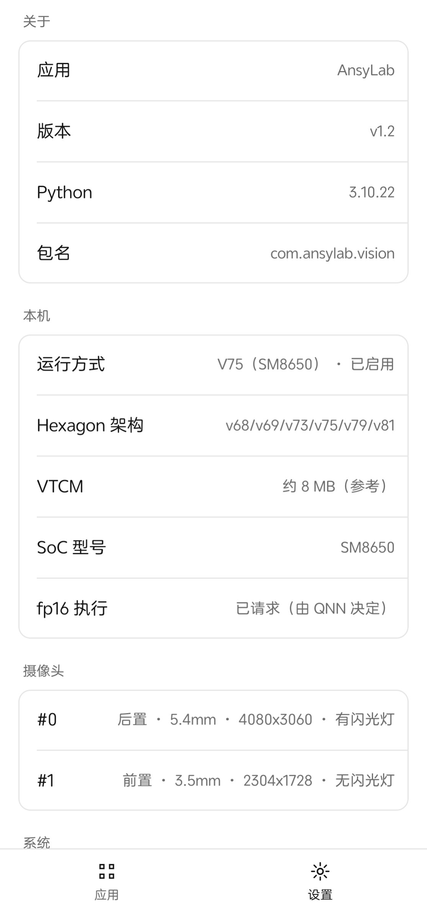
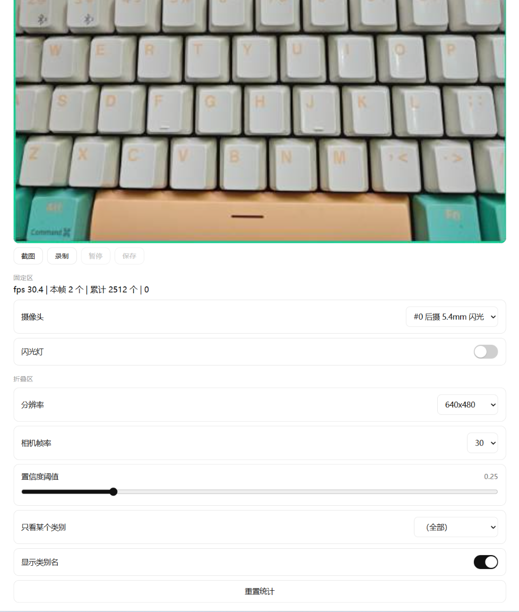

# AnsyLab

Android 上的**相机 + NPU + 传感器 + 串口**实验平台。

底层用 Kotlin 实现（CameraX 取帧、零拷贝帧池、Hexagon NPU 推理、USB 串口、IMU、控件系统、
网页服务），上层用 Python 写业务脚本。**改动业务逻辑不需要重新编译 APK** —— 脚本放在数据目录里，
导入即可运行。

参考设备：nubia NX769J（骁龙 8 Gen 3 / SM8650 / Hexagon V75），Android 16。

| 项 | 值 |
|---|---|
| 最低系统 | Android 11（API 30） |
| 架构 | arm64-v8a |
| 语言 | 中文 / English |
| 许可 | AGPL-3.0（因内置 YOLO 模型，见 [许可证](#许可证)）|

**目录**

- [它解决什么问题](#它解决什么问题)
- [界面预览](#界面预览)
- [运行机制](#运行机制)
- [二次开发](#二次开发)
- [1. 技术栈](#1-技术栈) · [2. 目录结构](#2-目录结构) · [3. 快速开始](#3-快速开始) · [4. 界面](#4-界面) · [5. 程序apps](#5-程序apps) · [6. 数据目录](#6-数据目录)
- [7. Python API](#7-python-api) · [8. 模型要求](#8-模型要求) · [9. 模型工具](#9-模型工具) · [10. 训练流程](#10-训练流程)
- [11. 内置程序](#11-内置程序) · [12. 调试](#12-调试) · [13. 已知限制](#13-已知限制) · [许可证](#许可证)

---

## 它解决什么问题

在 Android 上做视觉或硬件实验，通常要写一整个 App：申请权限、搭预览、处理相机帧、接 JNI、
调 NPU、画图表……每次改业务逻辑都要重新编译安装。

AnsyLab 把这一层固化下来，业务侧只写 Python：

```python
import ansylab
import cv2

cam = ansylab.Camera(640, 480)
cam.open()
view = ansylab.display()
model = ansylab.YOLO("yolov8n.onnx")

while ansylab.running():
    frame = cam.read()
    if frame is None:
        continue
    for x1, y1, x2, y2, cls, score in model.detect(frame):
        cv2.rectangle(frame, (int(x1), int(y1)), (int(x2), int(y2)), (0, 200, 255), 2)
        cv2.putText(frame, "%s %.2f" % (model.names[int(cls)], score),
                    (int(x1) + 2, int(y1) - 6),
                    cv2.FONT_HERSHEY_SIMPLEX, 0.45, (0, 0, 0), 3)
    view.show(frame)
```

这段代码直接跑在手机的 NPU 上，同时可以在浏览器里看画面、拖控件。

| 能力 | 说明 |
|---|---|
| 相机 | CameraX 取帧，零拷贝到 Python，支持多摄像头、固定帧率、对焦模式、闪光灯 |
| NPU | ONNX Runtime + QNN EP，Hexagon HTP 上运行，覆盖骁龙 888 ~ 8 Elite Gen 5 |
| 显示 | `AHardwareBuffer` 零拷贝上屏，支持等比留边 / 铺满 / 裁切 |
| 控件 | 18 种控件（滑块、下拉、摇杆、折线图、图片……），分固定区与折叠区 |
| 传感器 | 加速度、陀螺仪、磁力计、旋转矢量、欧拉角，可调采样率 |
| 串口 | USB 转串口（CH340/CP210x/FTDI/PL2303），文本与 HEX |
| 网页 | 局域网内浏览器看画面、操作控件、截图录制，无额外依赖 |
| 脚本管理 | 程序以目录形式存放，支持导入、排序、卸载，无需重新构建 |

---

## 界面预览

| 主页 | 目标检测（NPU 30 fps） |
|---|---|
|  |  |

| 姿态曲线 | 串口助手 |
|---|---|
|  |  |

| 控件总览 | 设置页 |
|---|---|
|  |  |

网页控制台（浏览器访问，无需安装 App）：



---

## 运行机制

### 分层

```
┌──────────────────────────────────────────────┐
│ Python 脚本（apps/<名字>/main.py）            │  业务逻辑：算法、流程、UI 组合
├──────────────────────────────────────────────┤
│ ansylab.py  →  PyBridge（JNI）                │  API 层
├──────────────────────────────────────────────┤
│ Kotlin：相机 / 帧池 / NPU / 串口 / IMU / 控件  │  平台能力
├──────────────────────────────────────────────┤
│ native：AHardwareBuffer 零拷贝帧池与显示缓冲   │
├──────────────────────────────────────────────┤
│ Android：CameraX、USB Host、Sensor、SurfaceView│
└──────────────────────────────────────────────┘
```

### 脚本怎么跑起来

1. 主页选中一个程序 → 进入程序页
2. App 从 `apps/<名字>/` 读取 `main.py`，在独立线程里用 CPython 3.10（Chaquopy 内置）执行
3. 脚本调用 `ansylab` 的 API，通过 JNI 驱动 Kotlin 层；界面更新被投递到主线程
4. 返回主页或切页 → 脚本收到停止信号，`while ansylab.running()` 退出
5. 框架统一释放资源：相机、串口、IMU、YOLO 会话，不会残留到下一个程序

同一时刻只运行一个脚本；启动新程序会先停止旧脚本。

### 一帧数据怎么走

```
CameraX ImageAnalysis
   └─> native 帧池（AHardwareBuffer，3 帧轮转）
         ├─> Python：cv2 可直接读的 ndarray（零拷贝视图）
         │     ├─> 模型推理（ORT → QNN → Hexagon HTP）
         │     └─> 绘制 / 计算
         └─> 显示：写回 AHardwareBuffer → SurfaceView
               └─> 网页：同一帧编码为 JPEG，MJPEG 推流
```

关键点：帧从相机到 Python 不复制，Python 到屏幕也不复制；只有网页推流需要编码。

### 程序是什么

一个程序 = 一个目录，目录名即显示名：

```
apps/myapp/
  main.py        入口（缺省取第一个 .py）
  icon.png       图标（可选）
  model.onnx     资源文件（脚本按 __file__ 相对路径加载）
```

导入方式：主页「+」→ 选文件夹或 zip，或通过 adb 拷到数据目录。**不需要重新编译 APK。**

---

## 二次开发

### 改业务逻辑

直接编辑 `main.py`，重新导入即可生效。调试时可以用 adb 下发脚本，免去反复导入：

```bash
adb push test.py /data/local/tmp/x.py
adb shell run-as com.ansylab.vision cp /data/local/tmp/x.py files/ansylab/scripts/x.py
adb shell am start -n com.ansylab.vision/.MainActivity \
    -e script /data/user/0/com.ansylab.vision/files/ansylab/scripts/x.py
```

### 常见扩展方向

| 想做的事 | 做法 |
|---|---|
| 换检测模型 | 放新的 `.onnx` 进程序目录，改 `YOLO(path)`；先跑 `probe_model()` 确认能上 NPU |
| 自己训练模型 | 见第 10 节：标注 → 训练 → `tools/model_convert` 转 ONNX → 导入 |
| 加新的传感器算法 | 用 `imu.sample()` 取原始数据，在 Python 里做滤波 / 融合（自带 scipy） |
| 接硬件协议 | `ansylab.Serial` 收发，自定义帧格式与校验 |
| 自定义界面 | 用 18 种控件自由组合，`region` 决定放固定区还是折叠区 |
| 远程控制 / 看画面 | 设置里打开「网页控制」，浏览器即可操作，脚本无需改代码 |
| 新增一个程序 | 新建目录 + `main.py` + `icon.png`，导入即出现在主页 |

### 能力边界

| 边界 | 说明 |
|---|---|
| 只能跑 arm64 | Chaquopy 与 OpenCV wheel 的限制，模拟器 x86 不可用 |
| 单脚本 | 同一时刻一个程序在跑，切页即停止 |
| NPU 有模型要求 | 图必须能被 QNN 整图接管，否则会回退 CPU 或崩溃，见第 8 节 |
| 网页仅局域网 | 服务监听本机网卡，不做公网穿透 |
| 无 pip | 设备端不能安装新包，依赖在构建期打包，见 7.0 |

---

## 1. 技术栈

| 组件 | 版本 | 说明 |
|---|---|---|
| Kotlin / AGP | 8.13.0 | compileSdk 35 / minSdk 30 / targetSdk 35 |
| Gradle | 8.13 | JDK 17 |
| NDK | 27.2.12479018 | 零拷贝帧池 |
| Chaquopy | 17.2.0 | CPython 3.10，打包进 APK |
| numpy / opencv-python | 1.23.3 / 4.5.1.48 | 离线 wheel，位于 `wheels/` |
| ONNX Runtime | onnxruntime-android-qnn 1.29.0 | QNN Execution Provider（Hexagon HTP） |
| usb-serial-for-android | 3.8.1 | JitPack 仓库；CH340/CH341/CH343、CP210x、FTDI、PL2303 |
| CameraX | camera-core / camera2 / lifecycle / view | RGBA_8888 输出 |

ABI 仅 `arm64-v8a`（Chaquopy 与 opencv wheel 均为原生库）。

---

## 2. 目录结构

```
app/src/main/
  java/com/ansylab/vision/
    MainActivity.kt        导航、脚本线程、显示回调、崩溃落盘
    HomeFragment.kt        程序网格、导入菜单、长按排序/卸载
    AppFragment.kt         程序页：固定区（视频/控件）+ 折叠区（控件）
    SettingsFragment.kt    设置页
    LogFragment.kt         日志页
    WidgetStore.kt         控件模型仓库
    WidgetViews.kt         控件视图构建
    JoystickView.kt        自绘摇杆
    CameraController.kt    CameraX 取帧、闪光灯、帧率控制
    CameraCatalog.kt       相机枚举、手电筒能力
    YoloSession.kt         ONNX Runtime + QNN EP 会话
    ModelProbe.kt          模型可用性自检
    ImuSensor.kt           姿态传感器采集
    SerialPortManager.kt   USB 串口收发
    Storage.kt             数据根目录、设置项
    DeviceInfo.kt          设备信息
    AppEntry.kt            程序仓库
    LocaleHelper.kt        语言切换
    PyBridge.kt            Python ↔ Kotlin 桥
  python/
    ansylab.py             Python API（相机/显示/控件/IMU/串口/YOLO/网页）
    ansylab_web.py         网页控制台（标准库 http.server）
    runner.py              脚本执行器
  cpp/native-lib.cpp       零拷贝帧池、AHardwareBuffer 显示缓冲
app/src/main/assets/demo/  内置示例程序（首次启动释放到 apps/）
tools/                     模型转换、数据集转换、量化
  model_convert/           .pt → .onnx 转换
docs/screenshots/          界面截图（README 引用）
.agent/                    临时脚本与示例源码（不参与构建，已 gitignore）
wheels/                    离线 pip 依赖
```

---

## 3. 快速开始

不需要自行构建时：

1. 从 Releases 下载 `AnsyLab-<版本>.apk`（约 140 MB）
2. 安装到 Android 11+ 的 arm64 设备，首次启动允许相机权限
3. 主页已预置 `yolo` / `serial` / `imu` / `widget` 四个程序，点开即运行
4. 需要网页控制时：设置 → 网页控制 → 打开，用浏览器访问显示的地址（默认密码 `123456`）

自行运行一个程序：主页「+」→ 导入项目文件夹（只拷贝 `icon.png` / `*.py` / `*.onnx`）。

### 构建


要求 JDK 17（`JAVA_HOME` 指向它）与 Android SDK（`local.properties` 中的 `sdk.dir`）。

```powershell
.\gradlew.bat :app:assembleDebug
adb -s <序列号> install -r -d app\build\outputs\apk\debug\app-debug.apk
```

发布构建：

```powershell
.\gradlew.bat :app:assembleRelease     # app\build\outputs\apk\release\app-release.apk
```

release 使用 `keystore/ansylab.jks` 签名（凭据在 `keystore/keystore.properties`，两者均不提交仓库）。
没有签名文件时只构建 debug 即可；debug 与 release 签名不同，互相覆盖安装需先卸载。

离线构建：Chaquopy 使用 `--find-links wheels/` 与 `--no-index`，依赖树已预下载。
新增 pip 包需联网，或手工将 wheel 放入 `wheels/`。

依赖仓库：`settings.gradle.kts` 额外声明 JitPack（usb-serial 仅发布于此）。

```kotlin
maven { url = uri("https://jitpack.io") }
```

---

## 4. 界面

```
MainActivity
├── HomeFragment      程序网格、「+」导入菜单、长按拖动排序/卸载
├── AppFragment       上：固定区（视频 + region="main" 控件，可滚动）
│                     下：折叠区（region="panel" 控件，默认折叠）
├── SettingsFragment  运行 / 网页控制 / 关于 / 本机 / 摄像头 / 系统 / 内存 / 存储
└── LogFragment       native.log 与 last_run.log 查看
```

- 底部导航：应用 / 设置；程序页隐藏底部导航，返回键回主页
- 进入程序页自动运行脚本
- 主页图标支持长按拖动排序，顺序持久化；长按同时进入选择模式
- 固定区高度：有视频时控件区限高（屏高 24%）可滚动；无视频时铺满

设置项：

| 分组 | 项目 |
|---|---|
| 运行 | 语言（中文 / English，默认中文）、画面缩放、日志 |
| 网页控制 | 开关、启用密码、访问密码、访问地址 |
| 关于 | 应用名、版本、Python 版本、包名 |
| 本机 | 运行方式（NPU 架构与状态）、Hexagon 架构、VTCM、SoC 型号、fp16 |
| 摄像头 | 每个相机的朝向、焦距、最大分辨率、闪光灯 |
| 系统 | 设备、芯片、系统版本、ABI |
| 内存 | 总内存、已用、可用 |
| 存储 | 总容量、可用、已用、数据目录占用、数据目录路径 |

---

## 5. 程序（apps）

一个程序对应 `apps/<名字>/` 目录，目录名即显示名。

```
apps/yolo/
  icon.png            图标（可选，缺省使用内置线条图标）
  main.py             入口（缺省取第一个 .py）
  yolov8n.onnx        模型（脚本按 __file__ 相对路径加载）
```

导入（主页「+」）：

| 入口 | 行为 |
|---|---|
| 导入项目文件夹 | SAF 选择目录，仅拷贝 `icon.png` / `*.py` / `*.onnx` |
| 导入项目压缩包 | 解压到 `apps/<zip名>/`，单层根目录自动剥离 |

首次启动会请求相机权限；未授权时 `Camera.open()` 拿不到画面，其余功能正常。

预置示例：APK 内置 `yolo` / `serial` / `imu` / `widget` 四个程序（`assets/demo/`）。
首次启动且 `apps/` 下无子目录时释放到 `apps/`；已存在任何程序则不执行释放。
删除全部程序后再次启动会重新释放。

卸载：长按图标进入选择模式（显示 ×），点击 × 确认删除；点击空白处或图标退出。

---

## 6. 数据目录

默认根目录 `/data/user/0/com.ansylab.vision/files/ansylab`：

```
<root>/
  apps/<程序名>/            导入的程序
  logs/native.log           Kotlin / 相机 / 串口日志（2 MB 上限，超出重开）
  logs/last_run.log         Python 输出（每次运行覆盖）
  logs/crash_last.txt       Kotlin 未捕获异常堆栈（启动时提示，查看后删除）
  scripts/                  adb 下发的临时脚本
  captures/                 导出文件（CSV 等）
  settings.json             配置快照
```

---

## 7. Python API

脚本就是普通的 `.py` 文件：一个目录（`apps/<名字>/`）放 `main.py` 和可选资源，进入程序页时自动执行。
`import ansylab` 即可使用全部能力。

```python
import ansylab

cam = ansylab.Camera(640, 480)
cam.open()
view = ansylab.display()
info = ansylab.label("启动中 ...", region="main")

buf = None
while ansylab.running():
    buf = cam.read_into(buf)      # 复用缓冲区，零分配
    if buf is None:
        continue
    view.show(buf)
    info.set("运行中")
```

### 7.0 运行环境

解释器为 CPython 3.10（Chaquopy 内置），设备上无 pip，依赖在构建期打包。

| 库 | 版本 | 用途 |
|---|---|---|
| numpy | 1.23.3 | 数值计算 |
| opencv-python | 4.5.1.48 | 图像处理 |
| scipy | 1.8.1 | 信号处理（滤波/插值）、优化 |
| pillow | 11.0.0 | 图像编解码 |
| pyyaml | 6.0.3 | 配置读写 |
| requests | 2.32.3 | HTTP 客户端 |
| python-dateutil | 2.9.0.post0 | 时间解析 |
| transforms3d | 0.4.2 | 旋转矩阵 / 欧拉角转换 |
| tqdm | 4.67.1 | 进度显示 |

说明：

- `numpy` 固定在 1.23.3：`scipy 1.8.1` 要求 `numpy < 1.25`
- `psutil` 不可用（Android 限制 `/proc` 访问）
- `filterpy`、`imutils`、`msgpack` 无 Android wheel，未包含
- 新增依赖需把 wheel 放入 `wheels/` 并在 `app/build.gradle.kts` 的 `pip { }` 中登记

### 7.1 脚本生命周期

```python
import ansylab

ansylab.running()      # 当前会话是否有效；切页/返回后变 False
ansylab.sleep(0.05)    # 可中断 sleep：切页后立刻抛 KeyboardInterrupt
ansylab.log("x")       # 写入界面日志行与 logs/last_run.log
ansylab.stats()        # 帧池统计（fps、丢帧、pin 状态）
ansylab.data_root()    # 数据根目录绝对路径
```

| 规则 | 说明 |
|---|---|
| 主循环写 `while ansylab.running():` | 否则切页后旧线程仍占用相机/串口 |
| 用 `ansylab.sleep()` 代替 `time.sleep()` | 切页后能立即退出，不必等 sleep 结束 |
| 脚本结束自动释放资源 | 相机、IMU、串口、YOLO 会话由框架统一关闭 |
| 异常会显示红色提示条 | 类型 + 出错行；完整堆栈见 `logs/last_run.log` |
| 不要在脚本里调用 `cv2.imshow` | 已移除，调用会直接抛异常 |

### 7.2 相机

```python
ansylab.Camera.list()       # [{'id','facing','focal','orientation','flash','level','maxSize'}]
ansylab.Camera.describe()   # 同上，多行文本

cam = ansylab.Camera(640, 480, fps=30, camera_id=None, focus="continuous")
cam.open()                  # 返回是否拿到首帧（失败返回 False）
```

| 参数 | 取值 | 说明 |
|---|---|---|
| `width` / `height` | 常用 640×480、1280×720 | 相机可能给出最接近的尺寸 |
| `fps` | 15 / 24 / 30，0 为默认 | 请求固定帧率，实际受设备能力限制 |
| `camera_id` | `"0"` / `"1"`，空为后置主摄 | 用 `Camera.list()` 查看可用 id |
| `focus` | `auto` / `continuous` / `infinity` / `none` | 对应 Camera2 对焦模式 |

读取帧的三种方式：

```python
bgr = cam.read()                 # 新分配 ndarray，简单但每帧分配内存
bgr = cam.read_into(buf)         # 复用缓冲区：尺寸不变时零分配
frame = cam.frame(timeout_ms=2000)   # 底层 Frame 对象，可直接取 RGBA
```

零拷贝写法（推荐在 30 fps 循环里使用）：

```python
buf = None
while ansylab.running():
    buf = cam.read_into(buf)     # 第一次传 None，之后一直复用同一块
    if buf is None:              # 超时或切页
        continue
    ansylab.display().show(buf)
```

其它操作：

```python
cam.torch            # 是否有闪光灯（bool）
cam.set_torch(True)  # 开关闪光灯
cam.torch = True     # 同上，属性写法
cam.current_id       # 实际生效的相机 id
cam.release()
```

`Frame` 对象（`cam.frame()` 的返回值）：

```python
frame.rgba()          # RGBA ndarray（零拷贝视图）
frame.bgr()           # 转成 BGR
frame.bgr(dst)        # 写入已有数组，避免分配
frame.close()         # 必须关闭，否则该帧不会被回收
with cam.frame() as f:   # 也可用上下文管理器
    ...
```

注意：

- 相机同一时刻只能被一个脚本占用；切页会停止脚本并释放相机
- 首帧通常需要 1–2 秒，`open()` 默认最多等 8 秒
- 未授予相机权限时 `open()` 返回 False，不抛异常

### 7.3 显示

```python
view = ansylab.display()      # 全局唯一，重复调用返回同一实例
view.show(frame)              # 传 BGR / 灰度 ndarray
```

- 走 `AHardwareBuffer` 零拷贝，不要每帧再 `cv2.cvtColor`
- 只有一个 display；再次调用 `display()` 只是取回同一个对象
- 画面缩放行为由「设置 → 画面缩放」控制（等比留边 / 铺满 / 裁切）
- 网页控制开启时，`show()` 会自动把帧推给浏览器，无需额外代码

### 7.4 控件

#### 7.4.1 两个区域

控件分两个区域，由 `region` 参数决定：

| `region` | 位置 | 用途 |
|---|---|---|
| `"main"` | **固定区**：视频下方，随页面滚动；有视频时限高（屏高 24%），无视频时铺满 | 需要边看画面边操作的控件 |
| `"panel"` | **折叠区**：页面底部「控件」栏，默认折叠 | 参数配置类，不常用 |

两个区域在网页控制台上显示为左右两栏。

**默认值是 `region="panel"`（折叠区）**，所以新建控件后如果看不见，先点开底部「控件」栏。

```python
ansylab.label("状态", region="main")     # 固定区，立即可见
s = ansylab.slider("阈值", 0, 1, 0.01, 0.5)          # 折叠区
s2 = ansylab.slider("阈值", 0, 1, 0.01, 0.5, region="main")
```

`image` 与 `display` 默认就在 `main`。`clear_widgets()` 可清空全部控件（每次进入程序页会自动清一次）。

#### 7.4.2 通用属性与方法

所有控件都继承以下接口：

```python
w.label = "新标签"        # 修改标题
w.visible = False         # 同 w.hide()
w.visible = True          # 同 w.show()
w.enabled = False         # 同 w.disable()（变灰、不可操作）
w.enabled = True          # 同 w.enable()
w.remove()                # 从界面移除
w.id                      # 内部 id（网页 API 用）
```

#### 7.4.3 控件清单

| 构造 | 读 | 写 / 方法 | 说明 |
|---|---|---|---|
| `label(text="", region="panel")` | `.text` | `.set(text)` | 单行只读文本 |
| `header(text="", region="panel")` | — | — | 加粗分组标题 |
| `divider(region="panel")` | — | — | 分隔线 |
| `button(label, region="panel")` | `.clicked` | — | 按下后为 True，读一次自动清零 |
| `toggle(label, value=False, region="panel")` | `.value` | `.value = bool` | 开关，整行可点 |
| `checkbox(label="", checked=False, region="panel")` | `.value` | `.value = bool` | 勾选框 |
| `slider(label, min=0.0, max=1.0, step=0.01, value=None, region="panel")` | `.value` | `.value = float` | 拖动条 |
| `text_field(label="", value="", region="panel")` | `.value` / `.submitted` | `.set_text(str)` | 单行输入，回车或「确定」提交 |
| `text_input(label="", value="", max_height=120, region="panel")` | `.value` / `.submitted` | `.set_text(str)` | 多行输入，自带确定按钮 |
| `text_output(text="", max_height=160, region="panel")` | `.text` | `.set(str)` / `.append(str)` | 多行输出，贴底自动跟随 |
| `radio_group(label="", items=None, index=0, region="panel")` | `.index` / `.value` / `.items` | `.index = i` / `.set_items(items, index=0)` | 单选组，选项全铺开 |
| `combo_box(label="", items=None, index=0, region="panel")` | `.index` / `.value` / `.items` | `.index = i` / `.set_items(items, index=0)` | 点整行弹出选项 |
| `progress_bar(label="", value=0, max=100, indeterminate=False, region="panel")` | `.value` | `.value = v` / `.set(v, indeterminate=None)` | 确定进度或转圈 |
| `image(label="", height=180, region="main")` | — | `.show(bgr_ndarray)` | 静态图显示，内部编码为 PNG |
| `plot(label="", points=200, channels=1, region="panel", y_min=None, y_max=None, window=0.0)` | — | `.push(*values)` / `.clear()` / `.export_csv(path=None)` | 折线图 |
| `joystick(label="", region="panel")` | `.x` / `.y` / `.value` | `.set(x, y)` | 单摇杆，范围 [-1, 1]，y 向上为正 |
| `double_joystick(label="", region="panel")` | `.left` / `.right` | `.set_left(x, y)` / `.set_right(x, y)` | 双摇杆并排 |
| `display(region="main")` | — | `.show(frame)` | 视频显示，全局唯一 |

读值约定：

- `.value` 对 `combo_box` / `radio_group` 返回**当前选项文本**，`.index` 返回下标
- `.value` 对 `text_field` / `text_input` 返回**当前文本**；`.submitted` 为 True 表示用户按了确定（读一次清零）
- `.clicked` 与 `.submitted` 都是「读一次清零」的脉冲式接口
- `joystick.value` 返回 `(x, y)`；`double_joystick.left` / `.right` 同样返回 `(x, y)`

#### 7.4.4 完整示例

```python
import ansylab

info = ansylab.label("等待操作", region="main")
slider = ansylab.slider("阈值", 0, 100, 1, 30, region="main")
combo = ansylab.combo_box("模式", ["快速", "精确"], 0, region="main")
switch = ansylab.toggle("启用滤波", True, region="main")
btn = ansylab.button("重置", region="main")
stick = ansylab.joystick("方向", region="main")

while ansylab.running():
    if btn.clicked:
        info.set("已重置")
        slider.value = 30
        combo.index = 0
    info.set("阈值 %.0f / 模式 %s / 滤波 %s / 摇杆 %+.2f,%+.2f"
             % (slider.value, combo.value, switch.value, stick.x, stick.y))
    ansylab.sleep(0.05)
```

#### 7.4.5 更新策略与注意事项

| 做法 | 说明 |
|---|---|
| 高频更新用 `.set()` / `.value =` | 就地刷新，不重建界面 |
| 不要在循环里 `set_items()` | 会重建控件区，打断正在进行的点击/拖动 |
| 创建是同步的 | `w = ansylab.slider(...)` 之后立刻读 `w.value` 就能拿到初值 |
| 界面刷新是异步的 | 同一轮循环里改两次值，界面可能只显示最后一次 |
| 控件数量 | 单页过多会拖慢布局，建议控制在 20 个以内 |
| 不要复用已 `remove()` 的对象 | 移除后该对象不再生效，需重新创建 |

### 7.5 折线图

```python
p = ansylab.plot("加速度", points=200, channels=3, region="main")
while ansylab.running():
    p.push(ax, ay, az)        # 参数个数决定同时画几条线
    ansylab.sleep(0.02)
```

| 参数 | 默认 | 说明 |
|---|---|---|
| `points` | 200 | 最多保留的点数（超出丢最旧的） |
| `channels` | 1 | 曲线条数，取值 1–5 |
| `y_min` / `y_max` | 自动 | 给定后固定 Y 轴范围 |
| `window` | 0 | 时间窗口（秒）；`> 0` 时按时间裁剪，0 表示按点数 |
| `region` | `panel` | 显示区域 |

```python
p.clear()                  # 清空数据
p.export_csv()             # 导出到 captures/plot_<时间戳>_<毫秒>.csv
p.export_csv("/sdcard/my.csv")   # 指定路径
p.window_points()          # 当前窗口内的点（列表）
```

说明：

- 时间窗口在手机侧裁剪好再发给网页，网页端与 App 端行为一致
- 导出 CSV 第一列是序号，其后每列一条曲线

### 7.6 IMU

```python
imu = ansylab.imu()
imu.enable("accel", "gyro", "game", rate_hz=50)

imu.acceleration        # (x, y, z) m/s²
imu.angular_velocity    # (x, y, z) rad/s
imu.magnetic_field / imu.gravity / imu.linear_acceleration
imu.rotation_vector     # (x, y, z, w)，含地磁
imu.game_rotation_vector
imu.quaternion          # (w, x, y, z)
imu.euler               # (方位, 俯仰, 横滚) 度
imu.pitch / imu.roll / imu.yaw
imu.accuracy("accel")   # 0~3，0 为不可信
imu.rotation_matrix()   # 3x3 旋转矩阵
imu.sample()            # ((ax,ay,az), (gx,gy,gz), (yaw,pitch,roll))，一次 JNI 取全
imu.disable() / imu.close()

ansylab.imu_available() # 本机可用传感器与最大采样率
```

| 要点 | 说明 |
|---|---|
| 传感器名 | `accel` / `gyro` / `game` / `mag` / `linear` / `gravity` / `rotation` |
| `rate_hz` | 请求采样率，设备可能给最近的可用值 |
| 读取频率 | 与采样率解耦，循环里按需读即可，越频繁越耗电 |
| 采样率上限 | 用 `imu_available()` 查看；通常 100–200 Hz |

注意：`getRotationMatrixFromVector()` 的入参必须是传感器原始 `[x, y, z, w]` 顺序，不可重排。

### 7.7 串口

```python
ansylab.Serial.list()          # [{'name','vendorId','productId','hasPermission',...}]

ser = ansylab.Serial(baud=115200, index=0, data_bits=8, stop_bits=1,
                     parity=ansylab.Serial.PARITY_NONE, flow=ansylab.Serial.FLOW_NONE)
ser.open()                     # 返回空串表示成功；首次需要系统 USB 授权
ser.write("hi\n")              # 接受 str 或 bytes
ser.read(256)                  # 非阻塞，返回 bytes（可能为空）
ser.read_line()                # 读到换行或超时
ser.read_until()               # 读到空闲或超时
ser.available                  # 缓冲区字节数
ser.stats()                    # {'open','name','rx','tx','pending','error'}
ser.set_dtr(True) / ser.set_rts(True) / ser.ctrl_lines
ser.close()
```

| 参数 | 取值 |
|---|---|
| `parity` | 0 无 / 1 奇 / 2 偶 / 3 标记 / 4 空格 |
| `flow` | 0 无 / 1 RTS-CTS / 2 DSR-DTR / 4 XON-XOFF |
| `baud` | 9600 / 115200 / 921600 等 |

注意：

- `read()` 是非阻塞的，循环里读不到数据时返回 `b""`，不要忙等，配 `ansylab.sleep(0.01)`
- 插拔会触发系统广播，`serial_list()` 重新枚举即可
- 脚本结束时框架会关闭串口；异常退出也会兜底关闭

### 7.8 YOLO

```python
model = ansylab.YOLO("model.onnx", conf=0.25)
dets = model.detect(frame, conf=0.3)   # [(x1, y1, x2, y2, cls, score), ...]
model.names                            # 来自模型 metadata
model.close()
```

| 参数 | 默认 | 说明 |
|---|---|---|
| `conf` | 0.25 | 默认置信度阈值 |
| `iou` | 0.45 | NMS 的 IoU 阈值 |
| `imgsz` | 模型内记录值，缺省 640 | 预处理边长 |
| `names` | 模型 metadata | 显式传入可覆盖 |
| `use_npu` | True | False 则强制 CPU |

行为说明：

- 类别名、类别数、输入尺寸全部来自 ONNX 的 `metadata_props`；模型没写时退化为 `class_0..N`
- 输出类别数取 `output[1] - 4`，不假定 80 类
- 优先使用 QNN/HTP；初始化失败自动回退 CPU，脚本不中断
- 首次建会话会编译图（1.5–6 秒），每次启动都会发生

模型可用性自检：

```python
info = ansylab.probe_model("/path/model.onnx")
# {'result': 'ok', 'init_ms': '2247', 'run_ms': '7.3',
#  'input': '1,3,640,640', 'outputs': '1,84,8400'}
```

| `result` | 含义 |
|---|---|
| `ok` | QNN 接管全部节点，推理成功 |
| `strict_fail` | QNN 认领不全，图被分段 |
| `run_fail` | 会话建立成功但执行失败 |

模型要求见第 8 节。

### 7.9 网页控制台

入口：设置 → 网页控制。

| 设置项 | 说明 |
|---|---|
| 网页控制 | 开关，打开时显示访问地址与说明 |
| 启用密码 | 关闭后无需登录（默认开启） |
| 访问密码 | 默认 `123456`，可修改 |
| 访问地址 | `http://<局域网IP>:8080` |

服务在运行程序时启动，回主页或切页时停止。地址选择顺序：192.168 > 172.16-31 > 其他 > 10.x。

脚本也可显式启动，此时不受设置开关影响，生命周期由脚本决定：

```python
web = ansylab.web(port=8080)
print(web.url)          # http://<局域网IP>:8080/
web.stop()
```

接口：

| 接口 | 说明 |
|---|---|
| `GET /` | 控制台页面（未登录显示登录页） |
| `POST /login` | 密码登录，写入 `ansylab_pw` cookie |
| `GET /stream` | MJPEG 流（`multipart/x-mixed-replace`） |
| `GET /api/widgets` | 控件状态 JSON |
| `GET /api/image?id=` | image 控件的 PNG |
| `POST /api/widget` | 操作控件 `{"id","action","value"}` |
| `GET /api/webstat` | 推流状态 |
| `WS /ws` | 控件状态推送，连接失败时退回 1 秒轮询 |

`action` 取值：`set_value`（滑块）、`set_flag`（开关/勾选）、`set_index`（下拉/单选）、
`set_text`（输入框）、`click`（按钮）、`set_joystick`（摇杆，`value=[x, y]`，双摇杆追加 `true`）。

实现要点：

- 标准库 `http.server`，无额外依赖
- 无客户端时不执行 JPEG 编码
- 每个客户端独立调整帧率与质量（15fps/q70 → 10fps/q60 → 7fps/q50），JPEG 编码复用
- 最多 3 个客户端，超出返回 503
- 控件推送依赖控件层 revision，无变化时不重建 JSON
- 固定区与折叠区在网页上分为两栏
- 脚本调用 `ansylab.display()` 后，网页视频下方出现截图 / 录制 / 暂停 / 保存（浏览器端 canvas + MediaRecorder）

---

## 8. 模型要求

NPU 通过 ONNX Runtime 的 QNN EP 执行，模型图必须满足以下条件：

| 项 | 要求 | 不满足的后果 |
|---|---|---|
| 整图可接管 | QNN 认领全部节点 | 图分为 QNN 段与 CPU 段，HTP 执行报错（6033 / 1007） |
| 算子 | 仅使用 QNN 支持的算子 | 同上 |
| BatchNorm | 已折叠进 Conv | 图被分段 |
| opset | 使用导出时的原生 opset | 属性被重写后解析失败 |
| 形状 | 输入、输出均为静态维度 | 无法编译 |
| 输入 | 单输入、NCHW、float32 | 需在脚本内转换 |
| 输出 | float32 | 非 float 类型无法传回 Python |

**判定方法**：建会话时设置 `session.disable_cpu_ep_fallback=1`。
会话建立成功即可整图接管；报 `graph nodes assigned to the default CPU EP` 则表示会被分段。

**兼容性**

导出参数：`opset=17, simplify=True, dynamic=False, imgsz=640`，fp32。

| 模型 | 建会话 | 推理 | 输出形状 | 状态 |
|---|---|---|---|---|
| yolov8n | 2.2 s | 7.3 ms | 1,84,8400 | 可用 |
| yolov8s | 3.3 s | 10.3 ms | 1,84,8400 | 可用 |
| yolov8m | 6.1 s | 18.3 ms | 1,84,8400 | 可用 |
| yolo11n | 2.1 s | 8.7 ms | 1,84,8400 | 可用 |
| yolo11s | 4.0 s | 11.7 ms | 1,84,8400 | 可用 |
| yolov5nu | 2.5 s | 8.6 ms | 1,84,8400 | 可用 |
| YOLOX-Tiny（Renesas 导出） | — | — | — | `strict_fail`（74 个未折叠 BatchNorm） |

---

## 9. 模型工具

### 9.1 转换（tools/model_convert）

`.pt` → `.onnx`，固定参数并做静态校验与 CPU 试跑。

```
输入：best.pt（PyTorch 权重）
输出：best.onnx（静态形状、opset 17、已简化）
```

**环境要求**

| 项 | 要求 | 说明 |
|---|---|---|
| 操作系统 | Windows / WSL / Linux / macOS | 均可 |
| Python | 3.9 – 3.12 | 3.13+ 部分依赖无 wheel |
| 内存 / 磁盘 | ≥ 4 GB / ≥ 2 GB | torch 本体约 1.5 GB |
| GPU | 不需要 | 只导出，不训练 |

```bash
pip install -r tools/model_convert/requirements.txt
# 国内网络
pip install -r tools/model_convert/requirements.txt -i https://pypi.tuna.tsinghua.edu.cn/simple
# 仅导出时可用 CPU 版 torch，体积更小
pip install torch torchvision --index-url https://download.pytorch.org/whl/cpu
```

**用法**

```bash
# 最简：同名输出
python tools/model_convert/convert.py runs/detect/train/weights/best.pt

# 指定输出路径
python tools/model_convert/convert.py best.pt -o <demo目录>/best.onnx

# 自定义输入尺寸 / opset
python tools/model_convert/convert.py best.pt --imgsz 320 --opset 17

# 跳过运行时校验
python tools/model_convert/convert.py best.pt --no-verify
```

| 参数 | 默认 | 说明 |
|---|---|---|
| `weights` | 必填 | 输入 `.pt` 权重 |
| `-o, --out` | 同名 `.onnx` | 输出路径 |
| `--imgsz` | 640 | 输入边长，必须与训练一致 |
| `--opset` | 17 | ONNX opset |
| `--batch` | 1 | 手机端固定 1 |
| `--no-simplify` | 关 | 跳过图简化 |
| `--no-verify` | 关 | 跳过 CPU 试跑 |

**输出示例**

```
[1/3] 导出 best.pt（imgsz=640 opset=17 simplify=True batch=1）
      完成 1.3s -> best.onnx
[2/3] 静态校验
      opset        17
      input        [1, 3, 640, 640]
      output       [1, 84, 8400]
      节点数       261（14 类算子）
      BatchNorm    0
      动态维度     无
[3/3] 运行时校验（CPU）
      执行成功 45.2 ms，输出 [(1, 84, 8400)]
```

退出码：`0` 通过；`2` 存在风险项，需上设备自检。

**校验项**

| 检查 | 不通过的含义 |
|---|---|
| 输入为 `[1,3,H,W]` | 不是检测模型的常见布局 |
| 无动态维度 | QNN 无法编译，App 加载失败 |
| `BatchNorm = 0` | 图会被 QNN 分段，HTP 执行崩溃 |
| opset ≤ 20 | 太新 QNN EP 不支持 |
| CPU 试跑成功 | 图本身有问题（算子 / 形状） |

**部署与自检**

```bash
# 方式一：App 内「导入项目文件夹」，选中含 main.py / icon.png / best.onnx 的目录
# 方式二：adb
adb push best.onnx /data/local/tmp/
adb shell run-as com.ansylab.vision cp /data/local/tmp/best.onnx files/ansylab/apps/mydemo/
```

```python
info = ansylab.probe_model("/data/user/0/com.ansylab.vision/files/ansylab/apps/mydemo/best.onnx")
# {'result': 'ok', 'init_ms': '2247', 'run_ms': '7.3', ...}
```

`result`：`ok` 可用；`strict_fail` 图被分段；`run_fail` 执行崩。

**常见问题**

| 现象 | 原因 | 处理 |
|---|---|---|
| `Unrecognized attribute: axis` | opset 太低 | 用默认 `--opset 17` |
| `BatchNorm 74` | 权重导出时未折叠 BN | 用 Ultralytics 官方导出链路 |
| `存在动态维度` | 导出带了 `dynamic=True` | 脚本已固定为 `False` |
| `执行失败` | 模型结构异常 | 用 `--no-simplify` 重试 |
| 首次导出很慢 | 加载 torch | 正常，后续几百毫秒 |
| 手机帧率偏低 | imgsz 或模型过大 | 换 `yolov8n/s` 或降低 imgsz |

### 9.2 内置模型来源

`app/src/main/assets/demo/yolo/yolov8n.onnx`：

| 项 | 值 |
|---|---|
| 权重 | `yolov8n.pt`（Ultralytics release `v8.3.0`） |
| 导出 | `ultralytics 8.4.207`，`opset=17, simplify=True, dynamic=False, imgsz=640` |
| 大小 / SHA-256 | 12,851,104 字节 / `5ADEE3B8…3D499C06` |
| 许可 | AGPL-3.0 |

复现：

```bash
pip install ultralytics
yolo export model=yolov8n.pt format=onnx opset=17 simplify=True dynamic=False imgsz=640
```

### 9.3 其他辅助脚本

数据集转换与量化脚本位于 `tools/`：

| 脚本 | 作用 |
|---|---|
| `tools/ndjson_to_yolo.py` | Ultralytics Platform NDJSON → YOLO 数据集（下载图片、写标签、生成 data.yaml） |
| `tools/quantize_yolo.py` | INT8 量化（QDQ、per-channel、uint8 激活） |
| `tools/validate_quant.py` | fp32 / int8 精度对比 |
| `tools/diag_quant.py` | 量化异常定位（输出分布、可疑节点） |

权重下载与推送脚本位于 `.agent/tools/`（临时工具，不随仓库发布）：

| 脚本 | 作用 |
|---|---|
| `.agent/tools/prepare_model.py` | 下载官方权重 → 调用 model_convert 导出 → 推送设备 |

## 10. 训练流程

以单类别检测为例：

```bash
# 1. 数据集
python tools/ndjson_to_yolo.py dataset.ndjson -o ~/dataset/demo

# 2. 训练
yolo detect train model=yolov8n.pt data=~/dataset/demo/data.yaml \
  epochs=200 imgsz=640 batch=16 device=0

# 3. 转 ONNX
python tools/model_convert/convert.py runs/detect/train/weights/best.pt \
  -o <demo目录>/demo.onnx

# 4. 自检（设备端）
# ansylab.probe_model(".../apps/<程序名>/demo.onnx")
```

环境要求：

| 项 | 要求 |
|---|---|
| GPU | 支持 CUDA 的 NVIDIA 显卡；WSL 内 `nvidia-smi` 可见 |
| torch | CUDA 版本（PyPI 的 linux wheel 自带 CUDA） |
| 显存 | yolov8n @640 batch16 约 2.1 GB |
| 数据集划分 | 按视频/场景划分，不按帧随机划分 |

新建 demo 目录：

```
<demo目录>/
  main.py       # 可复制 assets/demo/yolo/main.py，修改 MODEL 指向
  icon.png      # 256x256
  <model>.onnx  # 转换产物
```

把该目录放进 `app/src/main/assets/demo/` 后重新构建，即可随 APK 预置。

---

## 11. 内置程序

| 程序 | 内容 |
|---|---|
| `apps/serial` | 串口助手：文本/HEX 双栏、折线图（`%f,%f,...`，最多 5 路）、自定义指令、命令序列、接收自动保存、导出日志、自动发送、DTR/RTS |
| `apps/yolo` | NPU 检测：摄像头/闪光灯选择、分辨率/帧率下拉、置信度、类别过滤、类别名开关、统计重置 |
| `apps/mouse` | 单类别鼠标检测（yolov8n，自训练；未随 APK 预置，需自行导入） |
| `apps/widget` | 全部控件演示（固定区与折叠区各一份） |
| `apps/imu` | 姿态曲线：加速度 / 角速度 / 欧拉角，固定量程 + 10 秒窗口，可调采样率、暂停清零、导出 CSV |

其中 `serial` / `yolo` / `imu` / `widget` 预置在 APK 内（`assets/demo/`），首次启动释放到 `apps/`；
`mouse` 仅为示例源码，需自行导入。自定义程序用主页「+」导入，或通过 adb 拷贝到 `files/ansylab/apps/<名字>/`。

---

## 12. 调试

通过 adb 直接下发脚本（无需重新打包）：

```bash
adb push script.py /data/local/tmp/x.py
adb shell run-as com.ansylab.vision cp /data/local/tmp/x.py files/ansylab/scripts/x.py
adb shell am start -n com.ansylab.vision/.MainActivity \
    -e script /data/user/0/com.ansylab.vision/files/ansylab/scripts/x.py
```

日志：

```bash
adb shell run-as com.ansylab.vision cat files/ansylab/logs/last_run.log   # Python 输出
adb shell run-as com.ansylab.vision cat files/ansylab/logs/native.log     # Kotlin / 相机 / 串口
```

设备 logcat 输出有限，问题定位以这两个文件为主。
批量探测、性能测量、串口联调等临时脚本放在 `.agent/tools/`（不随仓库构建）。

串口电脑端联调：

```powershell
powershell -File .agent/tools/serial_pc_test.ps1 -Port COM10 -Send "PING"
powershell -File .agent/tools/serial_listen.ps1 -Port COM10 -Seconds 20
```

---

## 13. 已知限制

| 限制 | 说明 |
|---|---|
| 仅 arm64-v8a | 模拟器 x86 无法运行（Chaquopy / opencv wheel 限制） |
| 单脚本 | 同一时刻只运行一个脚本，切页会停止旧脚本并释放资源 |
| 推流限局域网 | 服务仅监听本机网卡，不做公网穿透 |
| 无列表控件 | 嵌套滚动冲突，未实现 |
| NPU 性能模式固定 burst | 不提供降频选项 |
| 模型须整图可接管 | 见第 8 节；分段会导致 HTP 执行失败 |
| 无 context 缓存 | 每次启动重新编译图，1.5–6 秒 |
| APK 体积 | 约 140 MB（HTP skel 66 MB + Python 运行时与库 45 MB + 内置示例 12 MB） |

---

## 许可证

**本项目整体采用 AGPL-3.0**（[LICENSE](LICENSE)）。

原因：项目内置并调用 Ultralytics YOLOv8 模型与其导出产物，而 Ultralytics 的代码与模型均为 AGPL-3.0；
按 AGPL 的传染性，与之结合发布的整体作品需以同一许可开源。

| 内容 | 许可 |
|---|---|
| 本项目源码（Kotlin / Python / 脚本） | **AGPL-3.0** |
| `assets/demo/yolo/yolov8n.onnx` | AGPL-3.0（Ultralytics 预训练权重导出） |
| Qualcomm QNN 运行库（随 ORT AAR 打包） | Qualcomm AI Engine Direct SDK 许可，非开源 |
| 第三方依赖 | MIT / Apache-2.0 / BSD / PSF，见第 1 节 |

AGPL-3.0 的主要义务：

| 场景 | 义务 |
|---|---|
| 自用、内部实验 | 无额外义务 |
| 分发 APK 或修改版 | 提供完整对应源码（含修改），保留版权与许可声明 |
| 通过网络提供服务（SaaS） | 同样需向使用者提供源码（§13） |
| 二次开发后发布 | 衍生作品继续使用 AGPL-3.0，不得改为闭源许可 |

如需闭源商用，需要移除 YOLO 相关组件（改用 Apache-2.0 的检测模型），或向 Ultralytics 购买商业许可。

## 致谢

- [Ultralytics](https://github.com/ultralytics/ultralytics) —— YOLO 实现与预训练权重
- [ONNX Runtime](https://github.com/microsoft/onnxruntime) —— QNN Execution Provider
- [Chaquopy](https://chaquo.com/chaquopy/) —— Android 上的 CPython
- [CameraX](https://developer.android.com/jetpack/androidx/releases/camera)、[usb-serial-for-android](https://github.com/mik3y/usb-serial-for-android)
